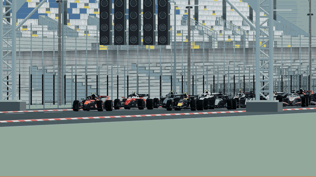
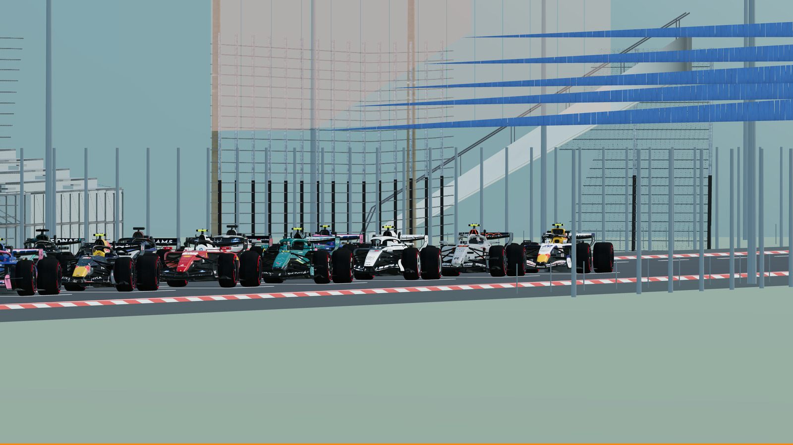
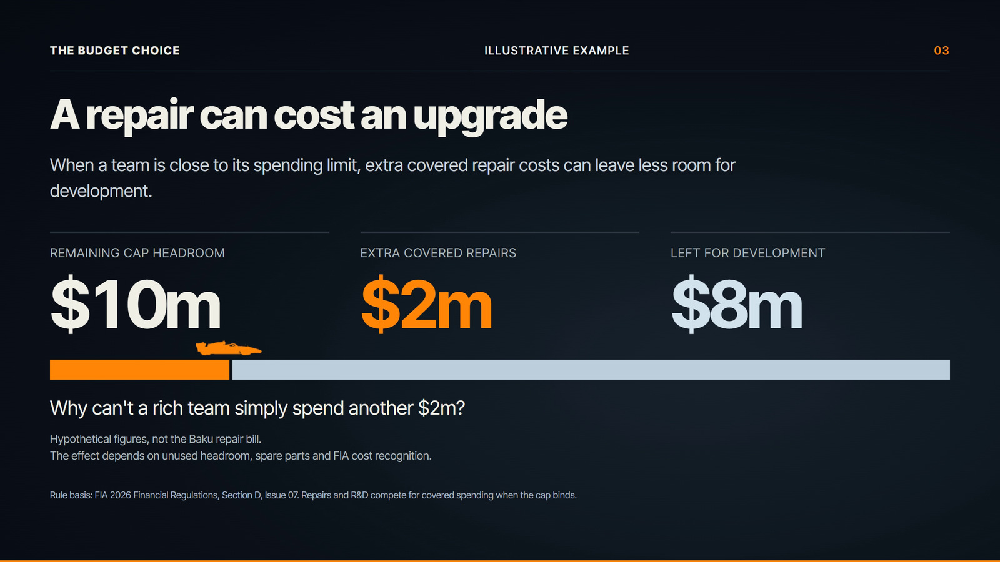
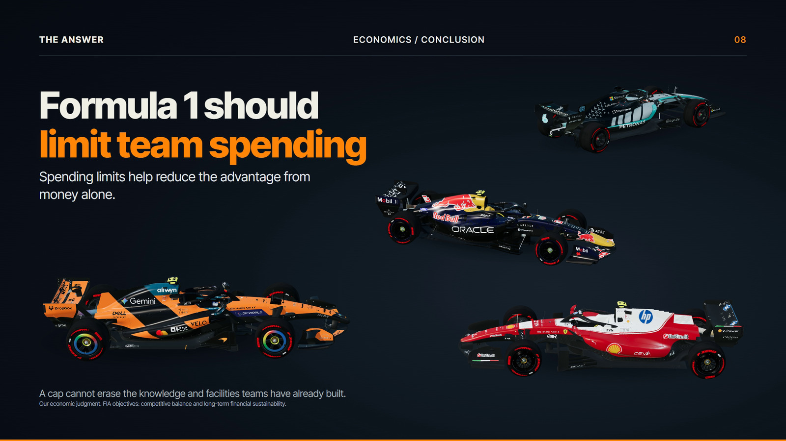

# F1 Economics

Eight-slide economics presentation with a 22-car Monza start, continuous 3D transitions, editable HTML typography and procedural V6 audio.

<!-- PROJECT-PREVIEW-START -->
## See it in action


[](https://github.com/Rayman0106/f1-economics-3d-deck/releases/download/v2026.10.20/F1-Economics-Highlights.mp4)

**[Watch / download the 40-second highlights](https://github.com/Rayman0106/f1-economics-3d-deck/releases/download/v2026.10.20/F1-Economics-Highlights.mp4)** · 1080p · 60 fps · silent

| Starting grid at Monza | Repair costs and the budget choice |
| --- | --- |
|  |  |
| **Development and competitive advantage** | **The final four-car composition** |
|  |  |

Visual excerpts from the saved final-deck recording. [Preview sources and timings](docs/media/SOURCES.md).
<!-- PROJECT-PREVIEW-END -->

## Run or rebuild

```sh
python build.py
python tools/check.py
```

Python standard library only. This builds `index.html`; open it in Edge or Chrome, wait for preparation, then click **Start**. Arrow keys change slides.

Ready-made presentation and visual previews: [Releases](https://github.com/Rayman0106/f1-economics-3d-deck/releases/latest).

## Project layout

```text
src/       Narrative, camera, scene, materials, typography and audio
assets/    GLB models and credited project inputs
seed/      Preserved engine shell
tools/     Build, verification, editing and local development
docs/      Preview gallery, licences and speaker script
build.py   Build entry point
```

The repository root contains entry points and project metadata. Old diagnostics, revision logs and redundant development captures are retained in the private original archive rather than mixed into this file list.

## Licence and assets

Application code is **MIT**. [Third-party notices](THIRD_PARTY_NOTICES.md) define the separate asset licences.

All converted car GLBs are retained. Blender authoring files are excluded. Models, fonts and other credited media remain under their own terms.
