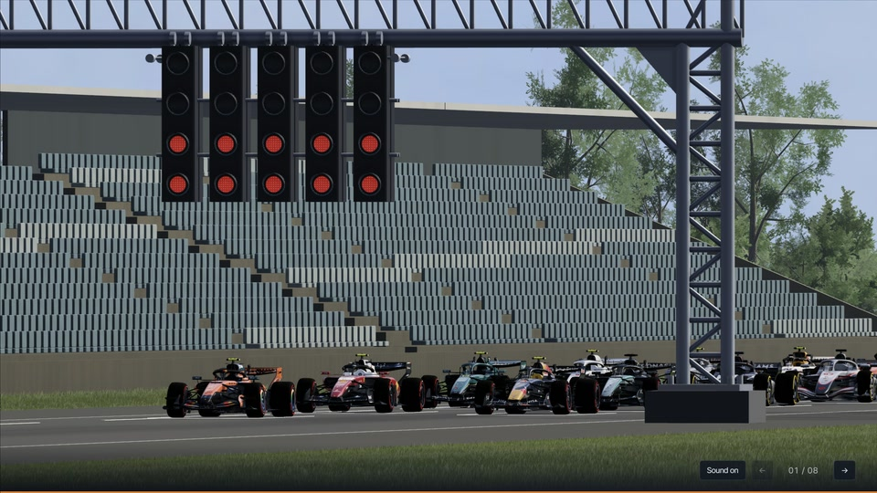
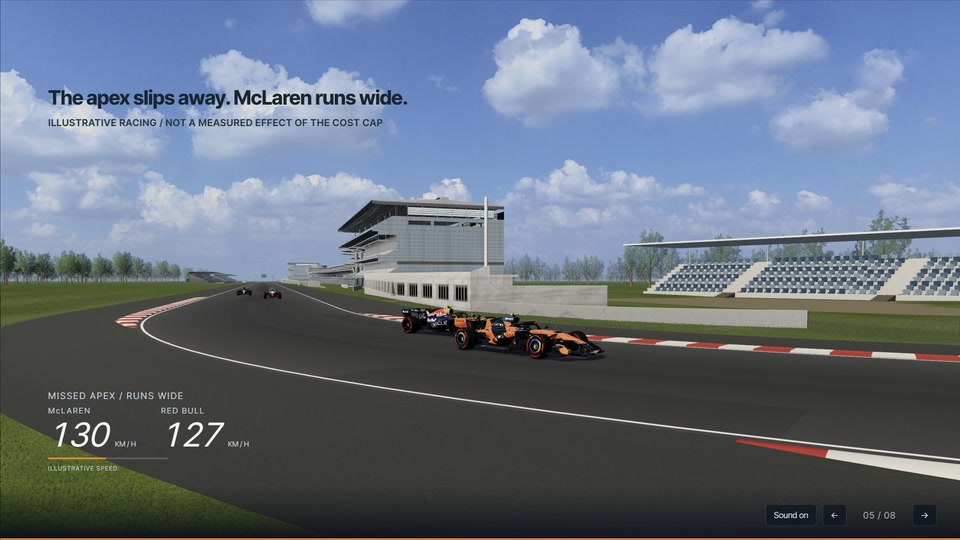

# F1 Economics

<!-- K-PROTOTYPE-START -->
> **K appearance candidate branch.** This branch adds lighting, architectural
> finish and track-surface detail on top of Final J, with the accepted camera and
> car choreography preserved. K is enabled by default; `?look=j` restores the J
> appearance. [Acceptance, actual K screenshots and remaining limits](docs/K-PROTOTYPE.md).
> The production release and the Final J gallery below remain available.

| K: lights and empty grandstands | K: corner kerbs and road finish |
| --- | --- |
|  |  |
<!-- K-PROTOTYPE-END -->

Eight-slide economics presentation with a 22-car Monza start, continuous 3D transitions, editable HTML typography and procedural V6 audio.

**Current production release: Final J (12 November 2026).** The accepted story and choreography now use the refined Monza scenery, daylight/HDR materials, stable opening shadows, parallel preparation and a 60 fps target. [Download the offline HTML](https://github.com/Rayman0106/f1-economics-3d-deck/releases/latest) · [What's changed, source map and measured limits](docs/FINAL-J.md).

<!-- PROJECT-PREVIEW-START -->
## See it in action


[](https://github.com/Rayman0106/f1-economics-3d-deck/releases/download/v2026.11.12-j/F1-Economics-J-Opening.mp4)

**[Watch / download the current J opening](https://github.com/Rayman0106/f1-economics-3d-deck/releases/download/v2026.11.12-j/F1-Economics-J-Opening.mp4)** · 16 seconds · silent · native scene frames exported at 30 fps

| Final J starting grid at Monza | Updated trackside grass and layered forest |
| --- | --- |
|  |  |
| **Daylight, car paint and the battle** | **Team inspection and architectural materials** |
|  |  |
| **Repair costs and the budget choice** | **Development and competitive advantage** |
|  |  |
| **The final four-car composition** | **Download the complete deck** |
|  | [Get Final J](https://github.com/Rayman0106/f1-economics-3d-deck/releases/latest) and click Start after preparation. |

These stills, GIF and opening clip were captured from the accepted **Final J** scene samplers on 12 November 2026, using the default broadcast look. The gallery now shows the current background and materials. [Capture sources, export size and timing](docs/media/SOURCES.md).

The older [October 40-second highlights](https://github.com/Rayman0106/f1-economics-3d-deck/releases/download/v2026.10.20/F1-Economics-Highlights.mp4) remain available as historical media.
<!-- PROJECT-PREVIEW-END -->

## Run or rebuild

```sh
python build.py
python tools/check.py
```

Python standard library only. This builds `index.html`; open it in Edge or Chrome, wait for preparation, then click **Start**. Arrow keys change slides.

Ready-made presentation and visual previews: [Releases](https://github.com/Rayman0106/f1-economics-3d-deck/releases/latest).

## Project layout

```text
src/       Narrative, camera, scene, materials, typography and audio
src/j/     Production lighting, scenery, shadow, preparation and frame-pacing modules
assets/    GLB models and credited project inputs
seed/      Preserved engine shell
tools/     Build, verification, editing and local development
docs/      Preview gallery, licences and speaker script
build.py   Build entry point
```

The root build uses `seed/final-j-shell.html` and repository-relative resources; no older workspace is required. See [Final J](docs/FINAL-J.md) for current versus legacy source entry points. Old development captures stay out of this file list.

## Licence and assets

Application code is **MIT**. [Third-party notices](THIRD_PARTY_NOTICES.md) define the separate asset licences.

All converted car GLBs are retained. Blender authoring files are excluded. Models, fonts and other credited media remain under their own terms.

<!-- CINEMATIC-SKILL-START -->
## Reusable design skill

The design and implementation experience from this deck and its companion project is documented in [**Cinematic 3D Decks · Skill**](https://github.com/Rayman0106/build-cinematic-3d-decks). It includes model adaptation, narrative continuity, camera movement, semantic typography, preparation, reusable tools and an offline interactive lab.

[Implementation lessons from this project](https://github.com/Rayman0106/build-cinematic-3d-decks/blob/main/references/f1-case-study.md)
<!-- CINEMATIC-SKILL-END -->
