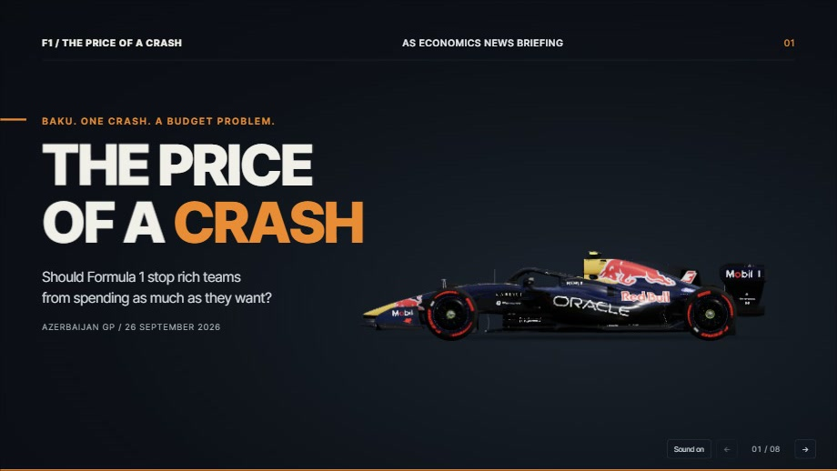
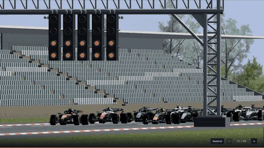
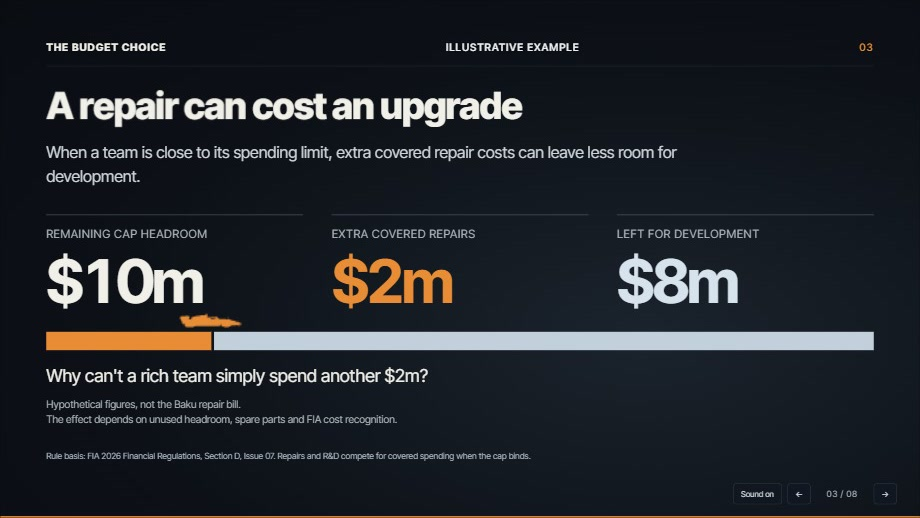
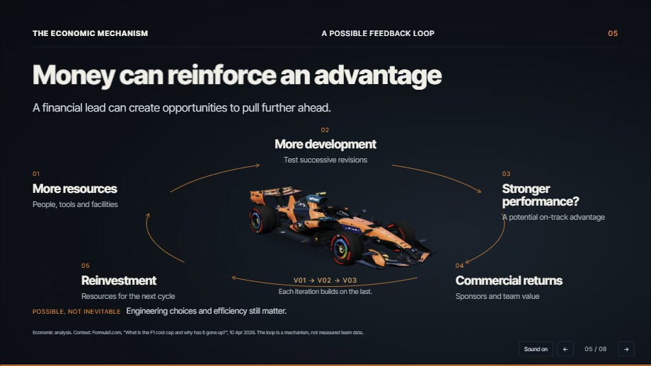

# F1 Economics

Eight-slide economics presentation with a 22-car Monza start, continuous 3D transitions, editable HTML typography and procedural V6 audio.

**Current production release: Final J (12 November 2026).** The accepted story and choreography now use the refined Monza scenery, daylight/HDR materials, stable opening shadows, parallel preparation and a 60 fps target. [Download the offline HTML](https://github.com/Rayman0106/f1-economics-3d-deck/releases/latest) · [What's changed, source map and measured limits](docs/FINAL-J.md).

<!-- PROJECT-PREVIEW-START -->
## See it in action



[](https://github.com/Rayman0106/f1-economics-3d-deck/releases/download/v2026.10.20/F1-Economics-Highlights.mp4)

**[Watch / download the 40-second highlights](https://github.com/Rayman0106/f1-economics-3d-deck/releases/download/v2026.10.20/F1-Economics-Highlights.mp4)** · 1080p · 60 fps · silent

| Starting grid at Monza | Repair costs and the budget choice |
| --- | --- |
|  |  |
| **Development and competitive advantage** | **The final four-car composition** |
|  |  |

Historical October excerpts, before the J scenery/material update; the choreography is retained. [Preview sources and timings](docs/media/SOURCES.md).
<!-- PROJECT-PREVIEW-END -->

## Run or rebuild

```sh
python build.py
python tools/check.py
```

Python standard library only. This builds `index.html`; open it in Edge or Chrome, wait for preparation, then click **Start**. Arrow keys change slides.

Ready-made presentation and visual previews: [Releases](https://github.com/Rayman0106/f1-economics-3d-deck/releases/latest).

## Project layout

```text
src/       Narrative, camera, scene, materials, typography and audio
src/j/     Production lighting, scenery, shadow, preparation and frame-pacing modules
assets/    GLB models and credited project inputs
seed/      Preserved engine shell
tools/     Build, verification, editing and local development
docs/      Preview gallery, licences and speaker script
build.py   Build entry point
```

The root build uses `seed/final-j-shell.html` and repository-relative resources; no older workspace is required. See [Final J](docs/FINAL-J.md) for current versus legacy source entry points. Old development captures stay out of this file list.

## Licence and assets

Application code is **MIT**. [Third-party notices](THIRD_PARTY_NOTICES.md) define the separate asset licences.

All converted car GLBs are retained. Blender authoring files are excluded. Models, fonts and other credited media remain under their own terms.

<!-- CINEMATIC-SKILL-START -->
## Reusable design skill

The design and implementation experience from this deck and its companion project is documented in [**Cinematic 3D Decks · Skill**](https://github.com/Rayman0106/build-cinematic-3d-decks). It includes model adaptation, narrative continuity, camera movement, semantic typography, preparation, reusable tools and an offline interactive lab.

[Implementation lessons from this project](https://github.com/Rayman0106/build-cinematic-3d-decks/blob/main/references/f1-case-study.md)
<!-- CINEMATIC-SKILL-END -->
