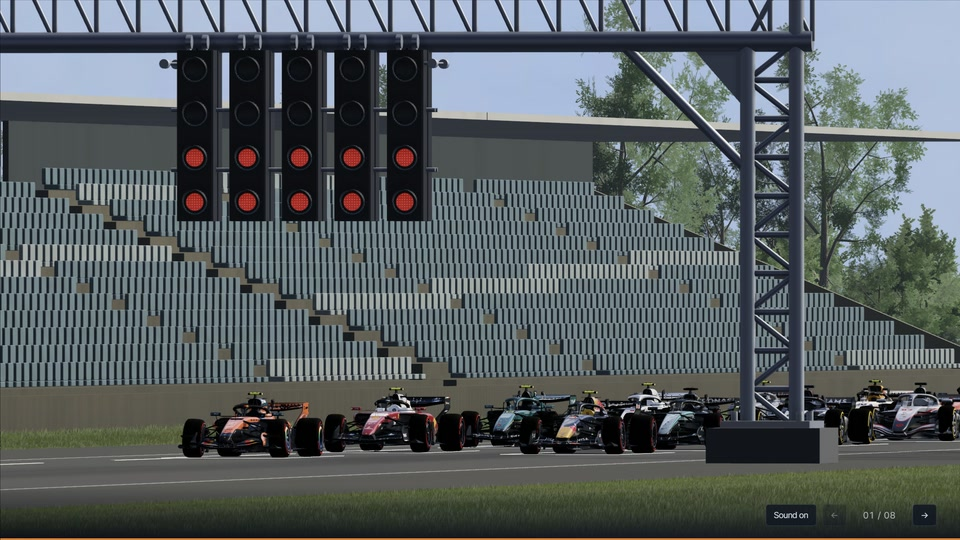
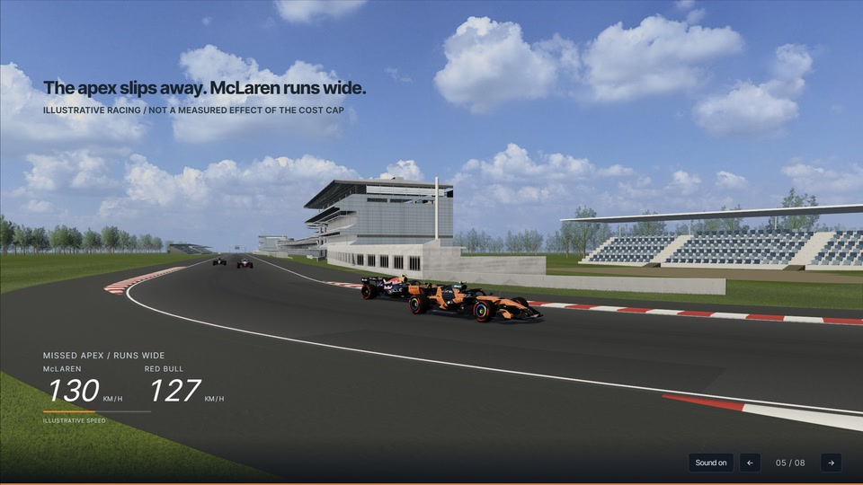
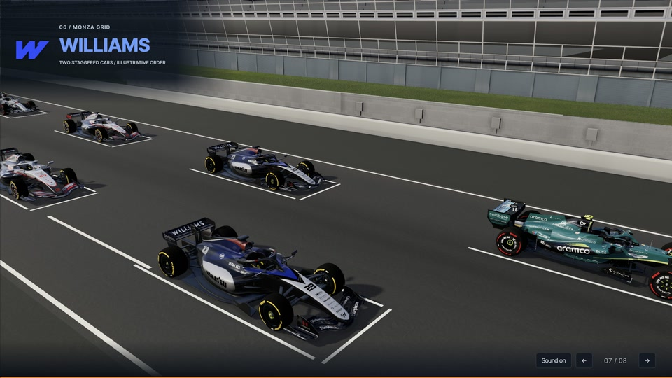

# K look prototype: acceptance and use

12 November 2026. This branch contains the K appearance prototype on top of
Final J. It is accepted for sharing as a candidate; the production Final J
release and main-branch gallery have not been replaced.

## Build and compare

```sh
python build.py
python tools/check.py
python -m http.server 8212 --bind 127.0.0.1
```

Open `http://127.0.0.1:8212/?look=k`, wait for preparation, and click Start.
This branch defaults to K. Use `?look=j` or `F1LookK.setEnabled(false)` for
the J look. Runtime toggling is a diagnostic operation and can recompile shaders.
The page title and briefing version retain their Final J baseline identity.

## What changed

- A lower, slightly warm sun; reduced world fill; opening-specific haze.
- Weathering on architecture, muted seat colours and filtered mowing bands.
- Corner kerbs and road rubber, braking wear, dust and repairs. Ten small meshes
  supplement the track; original asset geometry and all GLB files are preserved.
- Near shadow focus follows the visible cars nearest the camera. After the
  opening, architecture is kept out of the moving near shadow window.
- A Start fix found during acceptance: fullscreen is still requested in the user
  gesture, but a request that never settles stops blocking the deck after 1.5 s.
  The existing viewport warmup runs before the playback clock starts.

The authored cameras, actor trajectories, scene durations, eight-slide story,
typography, Monza setting and 60 fps target are unchanged.

## Observed acceptance

The visible in-app browser used Chrome 157 and an RTX 5070 Laptop through
ANGLE/D3D11. The post-start drawing buffer was checked at **2322 x 1306**;
the ready screen had initially used 1920 x 1080. This is not an Edge fullscreen
benchmark.

The opening and every adjacent transition completed at native elapsed time.
Frame intervals were observed from changes in `F1PlaybackJ.state().submitted`.
No screenshots were taken during timing; a small shadow-state sample ran every
20 submitted frames. The first frame and navigation work before it are excluded.

| Sequence | Measured intervals | P95 ms | Maximum ms | Above 25 ms |
| --- | ---: | ---: | ---: | ---: |
| opening | 1855 | 16.8 | 33.4 | 3 |
| 1-to-2 | 682 | 16.8 | 17.1 | 0 |
| 2-to-3 | 874 | 16.8 | 17.0 | 0 |
| 3-to-4 | 346 | 16.8 | 17.2 | 0 |
| 4-to-5 | 706 | 16.8 | 17.2 | 0 |
| 5-to-6 | 1102 | 16.8 | 17.2 | 0 |
| 6-to-7 | 2126 | 16.8 | 33.3 | 2 |
| 7-to-8 | 1528 | 16.8 | 17.1 | 0 |

Additional checks:

- `python build.py`, `python tools/check.py` and syntax checking of 24 assembled
  JavaScript blocks passed. Thirteen embedded models, audio, eight slides and
  seven transitions match the recorded inputs; runtime assets are offline.
- K/J native pose output was identical at nine sampled times across the opening,
  overtake, costs, battle, inspection and conclusion scenes.
- WebGL readbacks on slides 1 and 3 were identical with K enabled/disabled. Slide
  8 differed by at most one channel level, with a mean difference below 0.000001.
- Forward/reverse battle sampling agreed within 1e-7; the maximum numerical
  difference was 5.99e-11 in projected bounds. Returning from the battle to the
  same opening time restored both pose and shadow matrix exactly.
- Disabling K restored the original continuous kerbs on both route roots.
- K reported zero missed shader anchors; no window errors or console errors were
  captured. Existing ANGLE shadow-shader warnings and the upstream removed
  PCFSoftShadowMap warning remain.
- Separate still inspection covered overtake at 3.5 s, battle at 6.5/12.15 s,
  opening at 16.3 s and inspection at 15 s. No obvious floating kerb or seating
  break was seen in those views. Stills are not full-resolution motion review.

[Machine-readable evidence](K-ACCEPTANCE.json) · [Technical handoff](../handoff.md)

## Actual K captures







These are native scene screenshots, cropped to the stage and resized to
960 x 540. They were captured after the timing runs, without recolouring.

## Remaining observations

The opening had three two-vsync intervals and inspection had two. Existing
pre-first-frame navigation work, hidden-tab loading yields and the distant-car
37 m caster threshold in 1-to-2 remain outside this patch. Background buildings
currently have no separate static far-shadow layer after the opening. No GPU-time
trace or new complete video was recorded. The earlier hidden-pane/screenshot
652 ms observation was withdrawn and is not used as evidence here.
